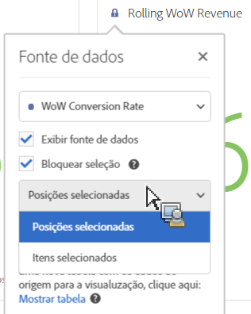

# Gerenciar fontes de dados {#manage-data-sources}

>[!CONTEXTUALHELP]
>id="workspace_freeformtable_lockselection"
>title="Bloquear seleção"
>abstract="Habilite esta configuração para bloquear a visualização nas posições selecionadas ou nos itens selecionados na fonte de dados."

>[!CONTEXTUALHELP]
>id="workspace_freeformtable_lockselection_showtable"
>title="Mostrar tabela"
>abstract="Selecionar **[!UICONTROL Mostrar tabela]** gera uma nova fonte de dados para a visualização atual, separada da fonte de dados original."

>[!CONTEXTUALHELP]
>id="workspace_freeformtable_showtable"
>title="Mostrar tabela"
>abstract="Selecione a opção **[!UICONTROL Mostrar tabela]** para gerar uma nova fonte de dados para a visualização atual, separada da fonte de dados original."

Cada visualização no Analysis Workspace é baseada em uma fonte de dados, normalmente uma tabela de forma livre. A sincronização de visualizações permite controlar qual tabela de forma livre ou fonte de dados corresponde a uma visualização e se a visualização permanece bloqueada para linhas específicas nessa tabela.

>[!TIP]
>
>Você pode identificar quais visualizações estão relacionadas pela cor  ao lado do título das visualizações. Cores iguais significam que as visualizações têm como base a mesma fonte de dados.
>

<!--
**Tip:** You can tell which visualizations are related by the color of the dot next to the title. Matching colors mean that visualizations are based on the same data source.

Managing a data source lets you show the data source or lock the selection. These settings determine how the visualization changes (or doesn't change) when new data comes in.

1. [Create a project](/help/analyze/analysis-workspace/home.md) with a data table and a [visualization](/help/analyze/analysis-workspace/visualizations/freeform-analysis-visualizations.md).
1. In the data table, select the cells (data source) you want to associate with the visualization.
1. In the visualization, click the dot next to the title to bring up the **[!UICONTROL Data Source]** dialog. Select **[!UICONTROL Show Data Source]** or **[!UICONTROL Lock Selection]**.

   

   Synchronizing a visualization to a table cell creates a new (hidden) table and color-codes the synchronized visualization with that table.

>[!BEGINSHADEBOX]

See  [Data source settings](https://video.tv.adobe.com/v/23729?quality=12&learn=on){target="_blank"} for a demo video.

>[!ENDSHADEBOX]

-->

## Definir configurações da fonte de dados {#configure}

1. No Analysis Workspace, vá para a visualização cujas configurações de fonte de dados ou bloqueio você deseja configurar.

1. Passe o mouse sobre a visualização e selecione o ícone **[!UICONTROL Configurações]** .

1. Selecione a guia **[!UICONTROL Fonte de dados]**.

   

1. Defina qualquer uma das seguintes configurações:

   | Configuração | Descrição |
   | --- | --- |
   | **[!UICONTROL Fonte de dados]** | Selecione a fonte de dados na qual a visualização se baseia. |
   | **[!UICONTROL Visualizações vinculadas]** | Lista todas as visualizações vinculadas à fonte de dados (tabela de forma livre). |
   | **[!UICONTROL Mostrar fonte de dados]** | Mostrar ou ocultar a fonte de dados (tabela de forma livre) que corresponde à visualização. |
   | **[!UICONTROL Bloquear seleção]** | Bloqueie a visualização para as linhas atualmente selecionadas na fonte de dados e selecione **[!UICONTROL Posições selecionadas]** ou **[!UICONTROL Itens selecionados]**. Consulte [Bloquear seleção](#lock-selection). |

## Bloquear seleção {#lock-selection}

Bloquear a seleção mantém uma visualização focada nas linhas selecionadas em sua fonte de dados, mesmo quando a tabela é alterada. Por exemplo, a tabela é alterada ao classificá-la ou filtrá-la, alterar seu intervalo de datas ou aplicar um segmento. Uma visualização bloqueada mostra  ao lado do título.

Se os segmentos, as dimensões ou as métricas na fonte de dados forem alterados e os dados bloqueados não estiverem mais visíveis, selecione **[!UICONTROL Mostrar tabela]** para gerar uma nova fonte de dados para a visualização, separada da fonte de dados original.

Ao bloquear a seleção, escolha uma das seguintes opções:

| Opção | Descrição |
| --- | --- |
| **[!UICONTROL Posições selecionadas]** | Bloqueia a visualização para as **posições** das linhas selecionadas na fonte de dados. Essas posições continuam sendo visualizadas, mesmo que os itens nelas mudem. Por exemplo, selecione essa opção para sempre mostrar os cinco principais nomes de campanha na fonte de dados, independentemente de quais campanhas eles são.  Se você bloquear linhas de detalhamento e essas linhas não estiverem mais na tabela, a visualização não será exibida. Para exibi-la novamente, atualize a tabela (por exemplo, seu intervalo de datas, segmentos ou filtros) ou atualize a seleção de bloqueio. |
| **[!UICONTROL Itens selecionados]** | Bloqueia a visualização para os **itens** específicos selecionados na fonte de dados. Esses itens continuam sendo visualizados, mesmo se a classificação na tabela mudar. Por exemplo, selecione essa opção para sempre mostrar os mesmos cinco nomes de campanha, independentemente da classificação. |
